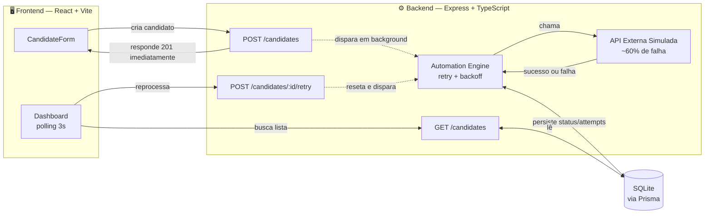
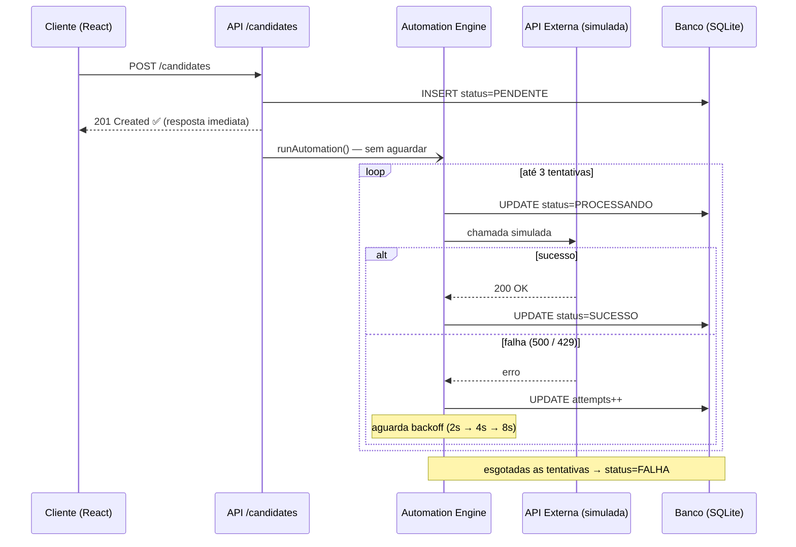

<div align="center">


### Sistema de cadastro de candidatos com engine de automação resiliente a falhas

<p>
  
  
  
  
  
  
  
</p>

<p>
  
  
  
</p>

</div>

<br />

## 📖 Sobre o projeto

No ecossistema do **Grupo Atalhos**, a captação de candidatos depende de automações externas, notificações, integrações e disparos que, na vida real, **falham**. APIs de terceiros ficam instáveis, sofrem limite de requisições (`429`) ou erram (`500`) sem aviso prévio.

Este projeto resolve esse problema com uma **engine de automação resiliente**: nenhum dado é perdido, toda falha é tratada, e o sistema tenta novamente sozinho com inteligência, não com força bruta.

> Cadastre um candidato. O sistema dispara a automação em segundo plano, sem travar sua resposta. Se falhar, ele tenta de novo automaticamente, com intervalos crescentes. Se esgotar as tentativas, você pode reprocessar manualmente com um clique.

<br />

## 🎬 Demonstração

<div align="center">

<!--
  👉 SUBSTITUA esta linha pelo GIF real da aplicação rodando.
  Veja a seção "Como gravar o GIF de demonstração" no final deste README.
-->


</div>

<br />

## 🧠 O problema, explicado

APIs externas instáveis são o pesadelo de qualquer engenheiro. O desafio real não é "chamar uma API" é **chamar uma API que não é confiável** e ainda assim entregar uma experiência confiável para quem usa o sistema.

Este projeto resolve isso com três decisões de arquitetura centrais:

| Decisão | Por quê |
|---|---|
| **Resposta HTTP nunca espera a automação** | O `POST /candidates` responde imediatamente após salvar no banco. A automação roda em *fire-and-forget*, desacoplada do ciclo de requisição/resposta. |
| **Retry com backoff exponencial** | Ao invés de tentar de novo instantaneamente (o que sobrecarregaria ainda mais uma API já instável), cada nova tentativa espera o dobro da anterior: `2s → 4s → 8s`. |
| **Nenhum dado é perdido** | Todo estado intermediário (`PENDENTE`, `PROCESSANDO`, `SUCESSO`, `FALHA`) e o número de tentativas ficam persistidos no banco a cada mudança nunca só em memória. |

<br />

## 🏗️ Arquitetura



<br />

## ⚙️ Como funciona o motor de retry



<br />

## ✨ Funcionalidades

- ✅ **Cadastro de candidatos** com validação client-side e server-side (nome, e-mail, cargo obrigatórios; LinkedIn opcional)
- ✅ **Disparo assíncrono de automação** a resposta HTTP nunca fica presa esperando a automação externa
- ✅ **Retry automático com backoff exponencial** (2s → 4s → 8s), até 3 tentativas
- ✅ **Simulação realista de instabilidade** ~60% de taxa de falha, alternando entre `SERVER_ERROR (500)` e `RATE_LIMITED (429)`
- ✅ **Dashboard em tempo real** com polling a cada 3 segundos sem necessidade de recarregar a página
- ✅ **Reprocessamento manual** de candidatos que esgotaram as tentativas automáticas
- ✅ **Tratamento de erros end-to-end** — 400 (validação), 404 (não encontrado), 409 (e-mail duplicado), 500 (erro interno) sempre com mensagens claras
- ✅ **100% tipado**, zero uso de `any` em toda a base de código

<br />

## 🛠️ Stack técnica

<table>
<tr>
<td valign="top" width="50%">

**Back-end**
- Node.js + Express
- TypeScript (modo `strict`)
- Prisma ORM
- SQLite
- ts-node-dev (hot reload)

</td>
<td valign="top" width="50%">

**Front-end**
- React 18 + TypeScript
- Vite (com proxy `/api` → back-end)
- Axios
- CSS puro com design tokens (sem framework de UI)

</td>
</tr>
</table>

<br />

## 🚀 Como rodar localmente

### Pré-requisitos
- [Node.js](https://nodejs.org/) 18+ instalado
- npm (vem junto com o Node.js)

### 1. Clonar o repositório

```bash
git clone https://github.com/joao-robertoo/atalhos-automation-engine.git
cd atalhos-automation-engine
```

### 2. Configurar e subir o back-end

```bash
# Instalar dependências
npm install

# Variáveis de ambiente (já incluído como exemplo SQLite não exige configuração externa)
# DATABASE_URL="file:./dev.db"  →  já está em prisma/.env

# Gerar o cliente Prisma e criar o banco local
npm run db:generate
npm run db:migrate

# Subir o servidor
npm run dev
```

O back-end sobe em **`http://localhost:3000`**.

### 3. Configurar e subir o front-end

Em **outro terminal**, sem fechar o back-end:

```bash
cd frontend
npm install
npm run dev
```

O front-end sobe em **`http://localhost:5173`** — abra essa URL no navegador.

> 💡 O Vite já está configurado com proxy de `/api` para `localhost:3000`, então não é necessário configurar CORS manualmente nem variável de URL da API no front-end.

<br />

## 📡 Referência da API

### `POST /candidates`
Cria um novo candidato e dispara a automação em background.

**Body:**
```json
{
  "nome": "Ana Souza",
  "email": "ana@empresa.com",
  "cargo": "Desenvolvedora Full Stack",
  "linkedin": "https://linkedin.com/in/ana"
}
```

| Status | Quando acontece |
|---|---|
| `201` | Candidato criado, retorna o objeto completo com `status: "PENDENTE"` |
| `400` | Campo obrigatório ausente ou e-mail em formato inválido |
| `409` | E-mail já cadastrado |

---

### `GET /candidates`
Lista todos os candidatos, ordenados do mais recente para o mais antigo.

**Resposta `200`:**
```json
[
  {
    "id": "cmt0ilvo6000012zwxh4fiocv",
    "nome": "Ana Souza",
    "email": "ana@empresa.com",
    "cargo": "Desenvolvedora Full Stack",
    "linkedin": "https://linkedin.com/in/ana",
    "status": "SUCESSO",
    "attempts": 1,
    "createdAt": "2026-08-20T00:32:59.917Z",
    "updatedAt": "2026-08-20T00:33:02.076Z"
  }
]
```

---

### `POST /candidates/:id/retry`
Força um novo ciclo de automação para um candidato com status `FALHA`.

| Status | Quando acontece |
|---|---|
| `202` | Reprocessamento aceito e iniciado |
| `400` | Candidato não está com status `FALHA` (evita condição de corrida com uma automação já em andamento) |
| `404` | Candidato não encontrado |

<br />

## 🧩 Decisões de arquitetura

<details>
<summary><strong>Por que <code>status</code> é <code>String</code> e não <code>enum</code> no Prisma?</strong></summary>
<br/>

O SQLite não possui suporte nativo ao tipo `enum` do Prisma. A validação do conjunto de valores válidos (`PENDENTE | PROCESSANDO | SUCESSO | FALHA`) foi movida para a camada TypeScript via *union type*, preservando a segurança de tipos sem depender de um recurso que o banco escolhido não suporta.
</details>

<details>
<summary><strong>Por que a automação nunca é aguardada (<code>await</code>) na rota de criação?</strong></summary>
<br/>

Porque o requisito central do desafio é que **falhas na automação externa não podem impactar a experiência de quem está cadastrando o candidato**. Se a rota aguardasse a automação, uma API externa lenta ou instável tornaria o cadastro lento ou instável também — exatamente o problema que o sistema deveria resolver.
</details>

<details>
<summary><strong>Por que o retry manual só é permitido em candidatos com status <code>FALHA</code>?</strong></summary>
<br/>

Para evitar uma condição de corrida: se fosse permitido reprocessar um candidato `PROCESSANDO`, duas execuções da engine rodariam simultaneamente para o mesmo registro, disputando as mesmas atualizações no banco. `FALHA` é o único estado terminal em que a engine automática garantidamente não vai mais tocar naquele candidato.
</details>

<details>
<summary><strong>Por que polling (3s) em vez de WebSocket para tempo real?</strong></summary>
<br/>

Para o escopo deste desafio, polling oferece a mesma percepção de "tempo real" para quem usa o sistema, com uma fração da complexidade de implementação e sem introduzir gerenciamento de conexões persistentes. É a opção correta para o tamanho do problema WebSocket seria over-engineering aqui.
</details>

<br />

## 🔭 Possíveis evoluções futuras

- [ ] Fila persistente (BullMQ + Redis) para os retries sobreviverem a um restart do servidor
- [ ] WebSocket para atualização instantânea do dashboard, sem polling
- [ ] Testes automatizados (Jest/Vitest) cobrindo a engine de retry e as rotas
- [ ] Autenticação e multi-usuário
- [ ] Exportação de relatórios de automações falhadas

<br />

## 👤 Autor

**João Roberto**
Desafio técnico desenvolvido para o processo seletivo de Desenvolvedor(a) Full Stack Jr/Pl Grupo Atalhos

<p>
  <a href="https://www.linkedin.com/in/joaoroberto">
    
  </a>
  <a href="https://github.com/joao-robertoo">
    
  </a>
</p>

<br />

---

<div align="center">
<sub>Construído com atenção a cada detalhe de resiliência porque sistemas confiáveis nascem assumindo que tudo vai dar errado, e se preparando para quando isso acontecer.</sub>
</div>
